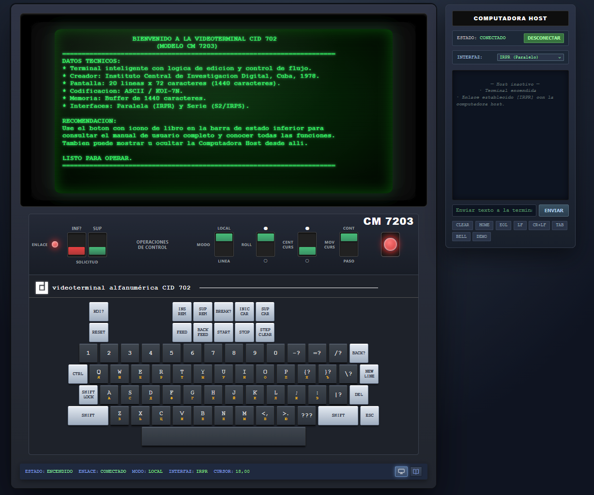
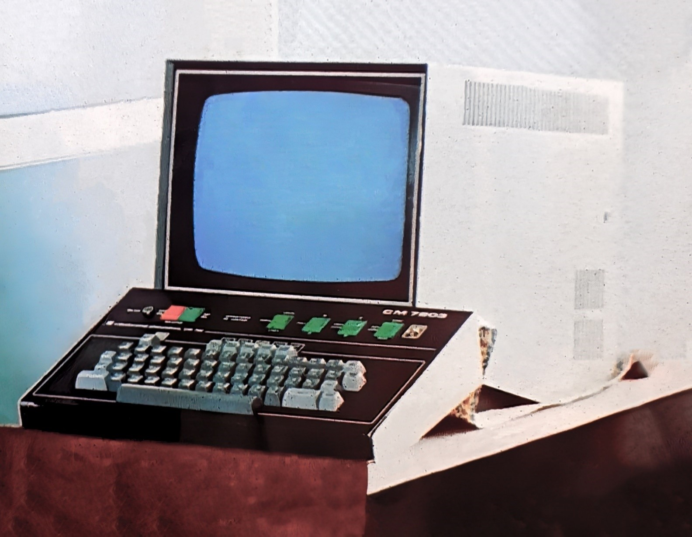

# CID 702 · CM 7203 — Emulador de Videoterminal

Un emulador en navegador del primer terminal de video alfanumérico producido en serie en Cuba (1978), designado internacionalmente como **SM‑7203 / CM 7203** dentro del sistema informático del COMECON.

<p align="center"></p>

[](index.html)
[]()
[](#)

Atención!! Esto es un proyecto en desarrollo.

---

## Índice
- [Acerca de](#acerca-de)
- [Demo en vivo](#demo-en-vivo)
- [Características](#características)
- [Inicio rápido](#inicio-rápido)
- [Especificaciones técnicas](#especificaciones-técnicas)
- [Arquitectura](#arquitectura)
- [Documentación](#documentación)
- [Compatibilidad con navegadores](#compatibilidad-con-navegadores)
- [Antecedentes históricos](#antecedentes-históricos)
- [Hoja de ruta](#hoja-de-ruta)
- [Cómo contribuir](#cómo-contribuir)
- [Créditos](#créditos)
- [Licencia](#licencia)
- [Español](#español)

---

## Acerca de

El **CID 702** fue diseñado en el **Instituto Central de Investigación Digital (ICID)** en La Habana y producido en serie a partir de 1978. Dentro de la familia informática del COMECON fue catalogado como **SM‑7203** (y posteriormente como **CM 7203**), convirtiéndose en el primer producto tecnológico cubano exportado internacionalmente.

<p align="center"></p>

Este proyecto recrea ese terminal en el navegador — reproduciendo fielmente su pantalla de 72×20 caracteres, la distribución del teclado cirílico KOI‑7Н y las tres interfaces de comunicación originales — para que su comportamiento pueda estudiarse, preservarse y disfrutarse sin necesidad de acceder al hardware original.

---

## Antecedentes históricos

El CID 702 fue desarrollado por el **ICID** en La Habana como el primer periférico diseñado para funcionar con la minicomputadora cubana **CID 300/10**. En 1978 superó las pruebas internacionales conjuntas en Severodonetsk (URSS) y entró en producción en serie. Dentro del COMECON fue catalogado como **SM‑7203**, y Cuba se convirtió en el primer país socialista en exportar periféricos de microcomputadora.

El hardware original utilizaba un controlador de CRT **Intel 8275** y un controlador de teclado **8279**, con un búfer de 1440 caracteres y soporte para la generación de caracteres cirílicos KOI‑7Н.

---

## Inicio rápido

No requiere instalación ni dependencias. Basta con abrir el archivo `CID_702.html` en un navegador moderno (Chrome, Firefox, Edge, Safari).

O ir a este vínculo: <https://maikelsz.github.io/CID702/CID_702.html>

---

## Características

- **Pantalla totalmente fiel**: rejilla de 72 × 20 caracteres (1440 celdas) con simulación de líneas de barrido de CRT y resplandor de fósforo.
- **Teclado KOI‑7Н**: subetiquetas cirílicas físicas con mapeo fonético (`A → А`, `J → Й`, …).
- **Modos LOCAL / LINE**: transmisión semidúplex con búfer y semántica de vaciado adecuados.
- **Tres interfaces de comunicación** simuladas con temporización real:
  - `IRPR` — paralelo, instantáneo
  - `S2` — serie V.24 / RS‑232, ~9600 baudios
  - `IRPS` — lazo de corriente, ~9600 baudios
- **Panel de host integrado** con registro TX/RX y botones de comando rápido.
- **Respuesta de audio**: sonidos distintos para pulsaciones de teclas y conmutadores.
- **Soporte de teclado físico** con respuesta visual en las teclas virtuales.
- **Un único archivo autocontenido** — sin paso de compilación, sin dependencias, funciona sin conexión.
- **Documentación bilingüe** (español + inglés).

---

## Especificaciones técnicas

Características del hardware emulado (según la documentación original del CM 7203):

| Especificación | Valor |
|---|---|
| Pantalla | 20 filas × 72 caracteres (1440 celdas) |
| Generador de caracteres | 64 ASCII + 160 latinos/cirílicos + 64 gráficos |
| Atributos | Parpadeo, video inverso, 7 colores |
| Búfer interno | 1440 caracteres |
| Codificación | ASCII / KOI‑7Н |
| Interfaces | IRPR (paralelo), S2 (serie V.24), IRPS (lazo de corriente) |
| Alimentación original | 110/220 V, 60/50 Hz, 200 W |
| Peso original | 22 kg (sin teclado) / 25 kg (con teclado) |

---

## Arquitectura

El emulador es un **único archivo HTML** que contiene todo el código:

```
index.html
├── <style>        CSS — simulación de CRT, distribución del teclado, paneles
└── <script>       JavaScript vanilla (sin framework)
    ├── T          Estado global del terminal
    ├── KEY_MAP    Mapeo de teclas físicas → virtuales
    ├── writeChar  Renderizado de caracteres con búfer en modo LINE
    ├── render*    Renderizado DOM (celdas en caché, actualizaciones O(1))
    └── hostSend   Transmisión host → terminal simulada
```

Decisiones clave de diseño:
- **Caché de celdas** (`CELL_CACHE`) — acceso al DOM en O(1), sin `querySelector` en la ruta crítica.
- **Caché con verificación de cambios** para la barra de estado — evita escrituras redundantes.
- **Transmisión con debounce** (`scheduleTxFlush`) — agrupa pulsaciones, evitando saturar el registro.
- **Modificadores de un solo uso** para Shift/Ctrl físicos; **conmutadores persistentes** solo desde clics de ratón.

---

## Compatibilidad con navegadores

Probado en:

| Navegador | Estado |
|---|---|
| Chrome / Edge (Chromium ≥ 90) | ✅ Soporte completo |
| Firefox ≥ 88 | ✅ Soporte completo |
| Safari ≥ 14 | ✅ Soporte completo |
| Móvil (Chrome/Safari) | ⚠️ Funciona, pero diseñado para escritorio |

Requiere `AudioContext` y sintaxis ES2017+ moderna.

---

## Hoja de ruta

- [ ] Atributos de color a nivel de celda (7 colores) con selector de paleta
- [ ] Renderizado de parpadeo y video inverso por celda
- [ ] Handshake realista (RTS/CTS/XON/XOFF) entre host y terminal
- [ ] Escalado responsivo para ventanas pequeñas
- [ ] Integración con el [emulador del CID 201‑B](https://github.com/[TU-USUARIO]/cid-201b-emulator) como sistema completo

---

## Créditos

- **Investigación histórica**:
  - Archivos del Instituto Central de Investigación Digital (ICID)
- **Proyectos relacionados**:
  - [Emulador del CID 201‑B](https://github.com/maikelsz/CIDmulatorCID201B/) — la primera minicomputadora que controló el CID 702
```
